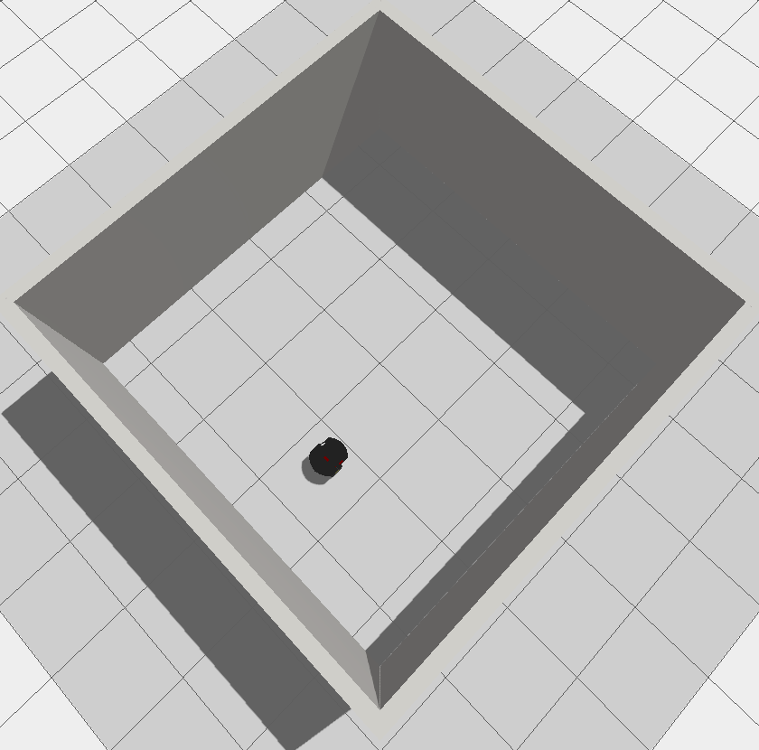
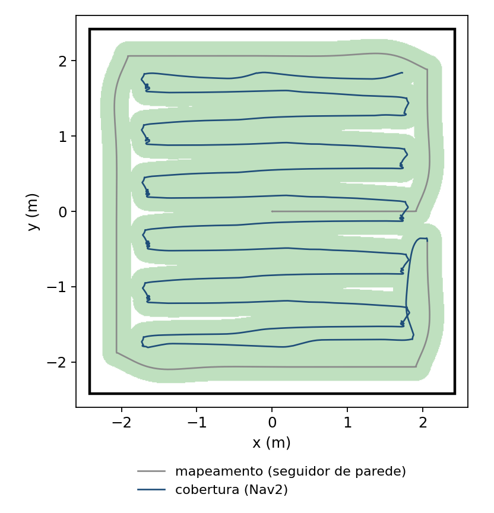
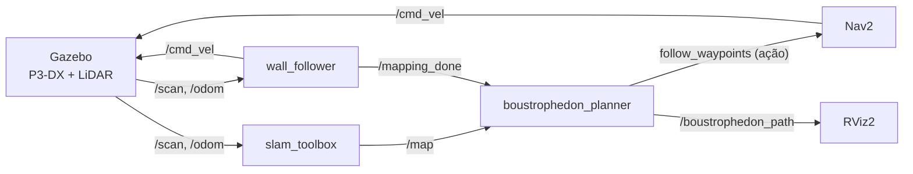
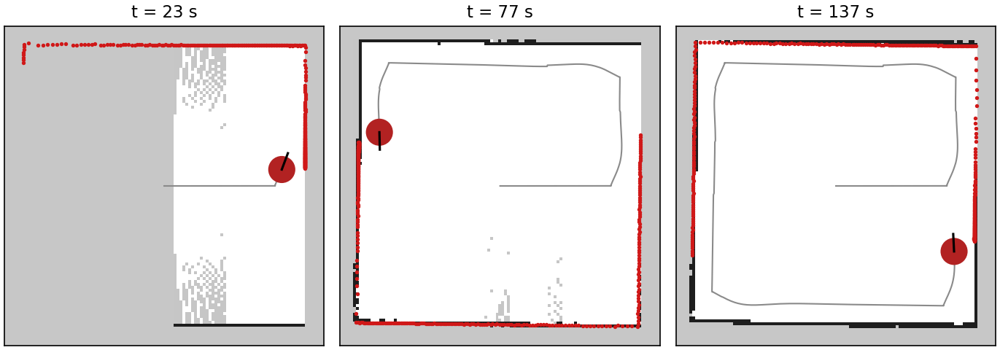
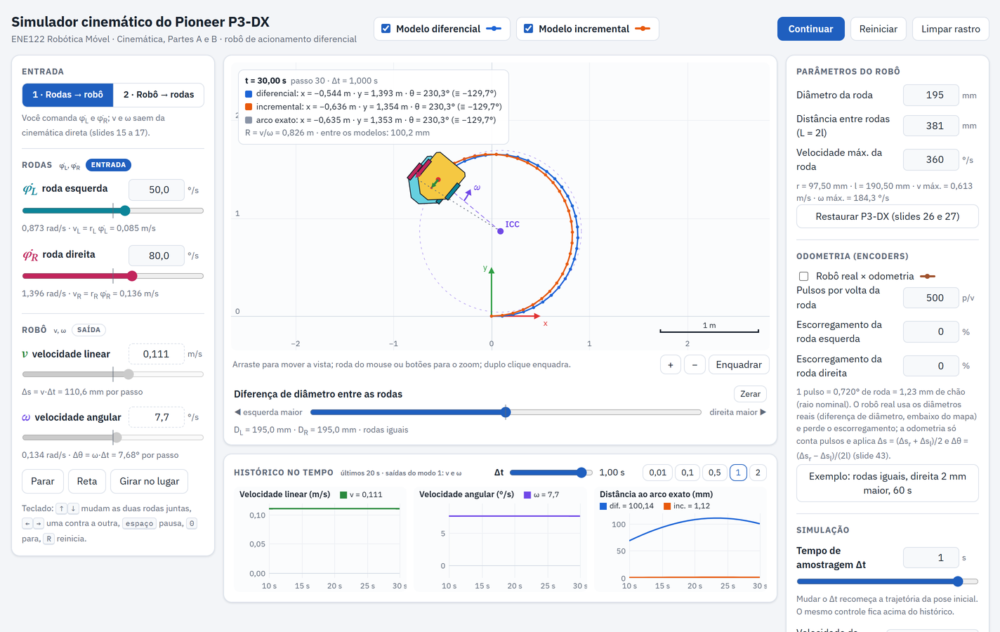

<h1 align="center">Autonomous Vacuum · Pioneer 3-DX</h1>

<p align="center">
  Robô de limpeza autônomo em ROS 2: o Pioneer 3-DX mapeia a sala sozinho e depois a percorre inteira em faixas de vaivém.
</p>

<p align="center">
  
  
  
  
  
</p>

<p align="center">
  
  &nbsp;
  
  <br><sub>À esquerda, a sala simulada no Gazebo. À direita, o trajeto de uma execução: o contorno do mapeamento, as faixas da cobertura e, em verde, a área varrida.</sub>
</p>

---

## Sumário

- [Visão geral](#visão-geral)
- [Como funciona](#como-funciona)
- [Instalação](#instalação)
- [Execução](#execução)
- [Parâmetros principais](#parâmetros-principais)
- [Estrutura do repositório](#estrutura-do-repositório)
- [Limitações conhecidas](#limitações-conhecidas)
- [Simulador cinemático do P3-DX (ENE122)](#simulador-cinemático-do-p3-dx-ene122)
- [Equipe](#equipe)

## Visão geral

O robô não recebe mapa nem rota prontos. Com um único comando, ele executa as três etapas da limpeza:

1. **Mapear.** Segue as paredes com o LiDAR até dar a volta completa na sala. Enquanto isso, o `slam_toolbox` monta o mapa de ocupação.
2. **Planejar.** Com o mapa pronto, gera uma rota *boustrophedon* (zigue-zague), com faixas paralelas a uma distância segura das paredes.
3. **Executar.** Envia a rota ao Nav2 como uma sequência de waypoints. O Nav2 conduz o robô e desvia do que estiver no caminho.

Tudo roda em simulação no Gazebo Fortress, com o modelo do Pioneer 3-DX e um LiDAR 2D de 180°.

## Como funciona



### 1. Mapeamento por seguimento de parede (`wall_follower`)

Uma máquina de estados a 20 Hz mantém a parede **à direita do robô**, a uma distância entre 30 e 40 cm (alvo de 35 cm). O LiDAR é lido em dois setores: a frente (−30° a +30°) e a direita (−90° a −60°).

| Estado | O que o robô faz |
| --- | --- |
| `SEEK_WALL` | Anda reto até encontrar uma parede à frente. |
| `TURN_LEFT` | Gira à esquerda até a frente liberar e ficar paralelo à parede da direita. |
| `FOLLOW_WALL` | Segue a parede com um controle PD: um termo corrige a distância, o outro mantém o robô paralelo. |
| `CORNER_FORWARD` | Na quina aberta (a parede da direita some), avança 50 cm. |
| `CORNER_TURN_R` | Gira 90° à direita para contornar a quina. |
| `FINISHED` | Para o robô e publica `/mapping_done`. |

O mapeamento termina quando o robô se afasta mais de 1,5 m do ponto inicial e depois volta a menos de 0,45 m dele. Nesse momento, o nó para o robô, publica `/mapping_done` três vezes e desliga o próprio laço de controle, deixando o `/cmd_vel` livre para o Nav2.

<p align="center">
  
  <br><sub>O mapa crescendo durante o seguimento de parede. Em vermelho, a leitura do LiDAR naquele instante; em cinza, o trajeto.</sub>
</p>

### 2. Planejamento da rota (`boustrophedon_planner`)

Quando recebe `/mapping_done`, o planejador lê o último `/map` e:

1. marca como área segura o interior da sala, afastado **0,38 m** das paredes;
2. traça faixas horizontais a cada **0,34 m**, na região em que a sala tem pelo menos 80% da sua largura útil máxima;
3. começa pelo canto mais próximo da posição atual do robô e alterna o sentido a cada faixa;
4. publica a rota em `/boustrophedon_path`, para visualizar no RViz2.

### 3. Execução com o Nav2

Cada faixa vira três waypoints (início, meio e fim), e a orientação de cada um já aponta para o próximo. A lista é enviada de uma vez à ação `follow_waypoints` do Nav2, que planeja e controla o movimento entre os pontos. O controlador é o DWB, com velocidade máxima de 0,26 m/s.

### Nó de segurança para teleoperação (`safety_distance`)

Este nó não faz parte do fluxo autônomo. Ele protege a condução manual: repassa os comandos do teclado (`/teleop_cmd_vel`) para `/cmd_vel` e bloqueia o avanço quando há obstáculo a menos de 0,30 m à frente. O avanço só volta a ser liberado acima de 0,60 m (histerese). Ré e giro continuam permitidos.

## Instalação

**Requisitos:** Ubuntu 22.04, ROS 2 Humble e Gazebo Fortress.

```bash
sudo apt install ros-humble-desktop ros-humble-navigation2 ros-humble-nav2-bringup \
  ros-humble-slam-toolbox ros-humble-ros-gz ros-humble-xacro \
  ros-humble-teleop-twist-keyboard python3-numpy python3-colcon-common-extensions
```

Clone o repositório **com o submódulo** e com o nome `pioneer_ws`, em `~/Desktop/Projects`. O launch procura os arquivos de configuração nesse caminho.

```bash
mkdir -p ~/Desktop/Projects && cd ~/Desktop/Projects
git clone --recurse-submodules https://github.com/Souza-LF/Autonomous-Vacuum-Pioneer-3DX.git pioneer_ws
cd pioneer_ws
source /opt/ros/humble/setup.bash
colcon build --packages-select p3dx_description vacuum_test
source install/setup.bash
```

> [!NOTE]
> Para a simulação, bastam os pacotes `p3dx_description` e `vacuum_test`. O `ros2aria`, que é o driver do robô real, depende da biblioteca [AriaCoda](https://github.com/reedhedges/AriaCoda) e só precisa ser compilado para usar o P3-DX físico.

## Execução

### Limpeza autônoma completa

```bash
ros2 launch vacuum_test vacuum_full.launch.py
```

O launch sobe os componentes em sequência, dando tempo para cada um ficar pronto:

| Tempo | Componente |
| --- | --- |
| 0 s | Gazebo com a sala (`sala.sdf`) e o Pioneer 3-DX |
| 3 s | `slam_toolbox`, em modo de mapeamento |
| 5 s | Nav2 e RViz2 |
| 7 s | `boustrophedon_planner`, que fica esperando o `/mapping_done` |
| 8 s | `wall_follower`, que começa o mapeamento |

Depois disso, não é preciso fazer nada: o robô mapeia, planeja e cobre a sala sozinho.

### Condução manual com proteção

```bash
# terminal 1: só a simulação
ros2 launch p3dx_description gz.launch.py

# terminal 2: filtro de segurança
ros2 run vacuum_test safety_distance

# terminal 3: teclado, publicando no tópico que o filtro escuta
ros2 run teleop_twist_keyboard teleop_twist_keyboard --ros-args -r cmd_vel:=/teleop_cmd_vel
```

## Parâmetros principais

| Componente | Valor | Para que serve |
| --- | --- | --- |
| `wall_follower` | 0,30–0,40 m (alvo 0,35 m) | Distância mantida até a parede da direita |
| `wall_follower` | 0,75 m | Acima disso, a parede da direita é considerada perdida (quina aberta) |
| `wall_follower` | 1,5 m / 0,45 m | Afastamento mínimo e raio de chegada que fecham a volta |
| `boustrophedon_planner` | 0,38 m | Margem entre a rota e as paredes |
| `boustrophedon_planner` | 0,34 m | Espaçamento entre faixas |
| `safety_distance` | 0,30 m / 0,60 m | Distância que bloqueia o avanço e distância que o libera (parâmetros ROS) |
| Nav2 (DWB) | 0,26 m/s; raio 0,22 m; inflação 0,55 m | Velocidade máxima, raio do robô e inflação do costmap |
| `slam_toolbox` | 0,05 m | Resolução do mapa |

Os valores do `wall_follower` e do `boustrophedon_planner` são constantes no código-fonte. Os do Nav2 e do SLAM ficam em `src/Pioneer-3DX-ROS2/config/`.

## Estrutura do repositório

```text
.
├── src/
│   ├── vacuum_test/                  # pacote deste projeto (ament_python)
│   │   ├── launch/vacuum_full.launch.py
│   │   └── vacuum_test/
│   │       ├── wall_follower_node.py
│   │       ├── boustrophedon_planner.py
│   │       └── safety_distance.py
│   └── Pioneer-3DX-ROS2/             # submódulo: modelo, mundos, driver e parâmetros
│       ├── p3dx_description/         # URDF/Xacro, malhas, mundos e launch do Gazebo
│       ├── ros2aria/                 # driver do robô real (AriaCoda)
│       └── config/                   # parâmetros do slam_toolbox e do Nav2
├── simulador_cinematica_p3dx/        # simulador web da cinemática (ENE122), fora do colcon
├── docs/                             # imagens deste README
└── vacuum.rviz                       # configuração do RViz2
```

## Limitações conhecidas

- **Validado apenas em simulação.** O teste no P3-DX real ainda está pendente.
- **Sala aproximadamente retangular.** O planejador limita a área útil a um retângulo em volta do espaço livre. Em salas em L, ou com reentrâncias, parte da área fica de fora.
- **Obstáculos no meio da sala.** As faixas não são divididas nos obstáculos internos. O Nav2 desvia deles, mas a área em volta pode ficar sem cobertura.
- **Caminho fixo.** O launch espera o workspace em `~/Desktop/Projects/pioneer_ws`. Para usar outro lugar, ajuste `ws_dir` em `vacuum_full.launch.py`.
- **Inicialização por tempo.** Os componentes sobem com atrasos fixos, não por eventos. Uma máquina mais lenta pode precisar de atrasos maiores.

---

## Simulador cinemático do P3-DX (ENE122)

<p align="center">
  
</p>

A pasta [`simulador_cinematica_p3dx/`](simulador_cinematica_p3dx/) traz um projeto independente: um simulador web da cinemática do robô de acionamento diferencial, feito para a disciplina de Robótica Móvel. Ele cobre:

- cinemática direta (rodas → robô) e inversa (robô → rodas), com gráficos que mudam conforme o modo de entrada;
- os modelos diferencial (Euler) e incremental, comparados com o arco exato, e o efeito do passo Δt;
- parâmetros do robô editáveis, diferença de diâmetro entre as rodas e odometria por encoders com escorregamento.

Para rodar, basta o Python, sem dependências:

```bash
cd simulador_cinematica_p3dx
python servidor.py
```

O servidor abre o simulador no navegador, em `localhost`. Para gerar um executável para Windows que dispensa o Python, use `python -m PyInstaller SimuladorP3DX.spec`. Os detalhes, as equações e a validação contra o código das aulas estão no [README do simulador](simulador_cinematica_p3dx/README.md).

A pasta tem um arquivo `COLCON_IGNORE`, então não interfere na compilação do workspace ROS 2.

## Equipe

Projeto acadêmico do curso de Engenharia Elétrica da **Universidade Federal de Juiz de Fora (UFJF)**.

| Projeto | Disciplina | Integrantes |
| --- | --- | --- |
| Robô de limpeza autônomo | ENE137 · Laboratório de Robótica Móvel<br>Profs. Iago Zanuti Biundini e Junior da Costa | José Geraldo Soares, Luis Filipe de Souza e Rayan Nascimento |
| Simulador cinemático | ENE122 · Robótica Móvel<br>Prof. André Luís Marques Marcato | José Geraldo Soares e Luis Filipe de Souza |
